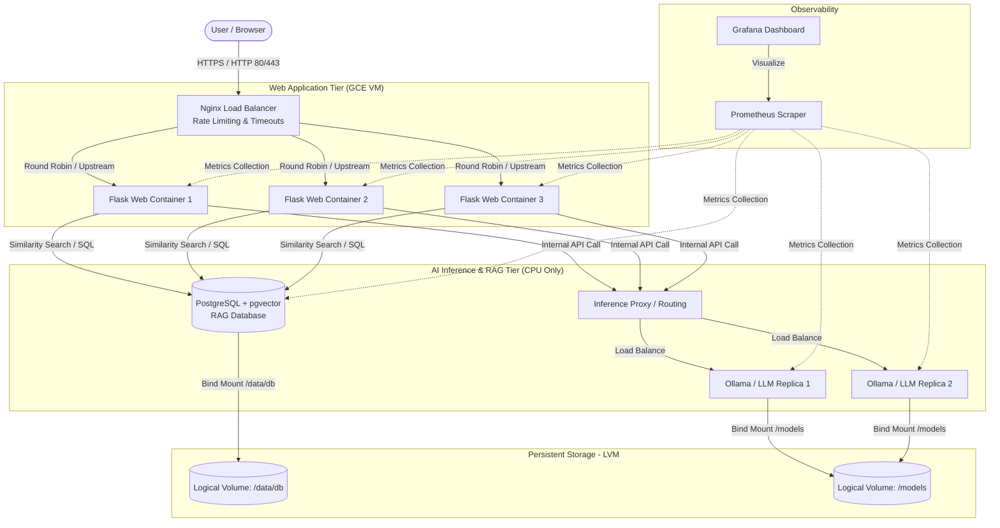

# [COP-3604-High Availability Containerized AI Application Deployment Project](https://github.com/nickolasddiaz/COP-3604-High-Availability-Containerized-AI-Application-Deployment-Project)

This a group project from Fall 2026 COP3604 – System Administration using UNIX at Florida Polytechnic University taught by professor Christian Navarro

## Objective

The primary objective of this team-based project is to architect, implement, and deploy a highly available, AI-enabled application on Google Cloud Platform (GCP) using Docker containers. The project demonstrates key system administration principles and practices applied to modern AI infrastructure, including self-hosted large language model (LLM) inference on CPU and retrievalaugmented generation (RAG).

## Application Description and Tech Stack

- **Practice problem helper**: An AI-powered interactive tutor/adaptive assessment bot that ingests multi-document PDF libraries to generate targeted practice questions and provide automated response evaluations.
- **PostgreSQL + pgvector**: Persistent storage, RAG database
- **Nginx**: Web server load balancer
- **Prometheus + Grafana**: System monitoring and observability
- **Python Flask**: Web framework in python for REST APIs
- **Self Hosted LLM**: To be decided
- **Docker**:
- **Cloud Compute**: Google Compute Engine (GCE)
- **Terraform**: Infrastructure as Code (IaC), Cloud Deployment
- **Security**: Google VPC (with firewall rules), Secret Manager and IAM service accounts

## File Structure

```bash
COP-3604-High Availability Containerized AI Application Deployment Project/$ tree -F
├── static/             # static files for flask, assets that are identical to every user
├── tempates/           # generates dynamic HTML layout structures.
├── app.py              # Flask app
├── .gitignore          # ignore files from being commited
├── .env.example        # example of a .env without exposing real values
├── README.md           # Documentation about this project
└── requirements.txt    # List of required python packages
```

## Diagram



## Scripts

1. **Installation**

   ```bash
    sudo apt update
    sudo apt install git -y
    sudo apt install python3 python3-pip python3-venv -y # Python 3.14 or later
    git clone https://github.com/nickolasddiaz/COP-3604-High-Availability-Containerized-AI-Application-Deployment-Project.git
    cd COP-3604-High-Availability-Containerized-AI-Application-Deployment-Project
    python3 -m venv .venv
    source .venv/bin/activate
    pip3 install -r requirements.txt
   ```

2. **Run the Python app**

  ```bash
    python app.py
  ```

  Specify ip address and port
  
  ```bash
    flask run --host=127.0.0.1 --port=5000
  ```

## Contributers

- Andres Saldarriaga
- Nickolas Diaz
- Sydney Prall
- Jordan Baumann

## Project Overview

Students, working in groups of 3-4, will deploy a multi-tiered application on GCP. The application will consist of a web-based front end, a self-hosted LLM inference service running on CPU only, and a vector or graph database that supports retrieval-augmented generation (RAG), all containerized with Docker. Student groups may choose the application, model, and database, all of which can be downloaded from any source that is open source or a commercial trial. The application should be personalized a marginal amount, such as changing text on a landing page, and must include at least one AI-powered feature that answers user questions using content retrieved from the team's database. Students will configure high availability for the application and AI inference tiers, build a load balancing solution for ingress (i.e., GET requests and AI requests), implement persistent storage using Linux Logical Volumes, enforce resource limits and network security for the inference service, and collect observability metrics. The entire infrastructure, all containers, and all configuration must be built automatically by a VM startup script or Terraform, without manual commands. This ensures reproducability and reliability during recovery

## Requirements

- **Application Deployment:**
  - A multi-tiered application consisting of a web front end, an AI inference service, and a RAG database. The application does not have to be custom; you may download an open-source images or trial application but provide citation regarding source.
  - At least one AI-powered feature (e.g., chat assistant, question answering, or search over the application's content) that uses RAG:
    - User question → retrieve relevant content from the database → send the question plus retrieved context to the LLM → return the answer to the user, showing which source(s) were used.
  - Docker containers for the web application, the inference service, and the database.
  - Minimum of 3 always active web front-end containers with max (automatic) scaling of 6.
    - i.e., 3 web front-end containers, 2 inference containers, 1 database container
  - Deployment on Google Compute Engine (GCE) instance(s).
- **AI Inference (Local Inference, CPU Only):**
  - A self-hosted model server running in a container (e.g., Ollama, llama.cpp llamaserver, or vLLM CPU build).
  - **CPU only**. GPUs are not permitted due to cost. External or managed LLM APIs (e.g., Vertex AI, OpenAI, Anthropic) may not be used to generate answers or embeddings.
  - Use an open-weight, quantized model sized for CPU inference (e.g., Llama 3.2 1B/3B, Qwen2.5 1.5B/3B, Gemma 2 2B, Phi-3.5-mini). Cite the model card and license.
  - Embeddings for RAG must also be generated locally (e.g., nomic-embed-text, allMiniLM-L6-v2).
  - Recommended inference VM size: e2-standard-4 (4 vCPU, 16 GB RAM) or larger. Verify CPU instruction support (e.g., AVX2) with lscpu
- **RAG Database (Vector or Graph):**
  - A vector or graph database running in a container, for example:
    - Vector: PostgreSQL + pgvector, Qdrant, Weaviate, Milvus, or Chroma (server mode)
    - Graph: Neo4j Community Edition or Memgraph
  - Database storage must be mapped to a volume (bind mount) located on an LVM logical volume so data persists across container restarts, container re-creation, and VM reboots
  - The database must be populated automatically by an ingestion script (load documents → chunk → embed → store) using a document set chosen by the team (minimum of 25 documents or chunks). Ingestion must be idempotent: re-running it must not create duplicates.
  - The database must be reachable only by the application and inference containers, not from the internet.
- **High Availability:**
  - High availability for the application tier: multiple container replicas (minimum of 3 web front-end containers).
  - High availability for the AI tier: minimum of 2 inference replicas behind the load balancer.
  - Health checks must verify readiness, not just an open port (e.g., the model is loaded and responds to a test prompt).
  - Containers restart automatically (restart policy). If all inference replicas are unavailable, the application must degrade gracefully (friendly error message, rest of the application still works) instead of crashing.
- **Load Balancing:**
  - Load balancing for both the web front end and the inference tier (e.g., using Nginx, Traefik, or HAProxy).
  - Configure the load balancer for long-running LLM requests: increased read/proxy timeouts and buffering disabled for streamed responses (SSE/chunked).
  - Rate limiting on the AI endpoint (e.g., Nginx limit_req) that returns HTTP 429 when the limit is exceeded.
- **Persistent Storage (LVM):**
  - Persistent storage for the application data, RAG database, and model weights using Linux Logical Volume Manager (LVM).
  - At least two separate logical volumes: one for database data (e.g., /data/db) and one for model weights (e.g., /models).
  - Volumes mounted persistently (/etc/fstab ) and mapped into containers to ensure data persistence across container restarts and instance failures.
  - Take an LVM snapshot.
  - Model files pre-staged in VM logical volume. Models do not need downloaded at build time. This is due to added complexity and costs of storage buckets.
- **Automation:**
  - Demonstrate an automation solution:
    - Avoid managing entire infrastructure with individual commands.
    - A VM startup script and/or Cloud Shell or Terraform scripts must build all infrastructure (VPC, subnets, firewall rules, VMs, containers, and configurations.
    - Infrastructure should be set up with a single command (e.g., terraform apply or one deploy script).
  - The startup script runs on every VM start and must be idempotent: it checks the current state and only builds or configures what is not already configured (e.g., install Docker, create LVM, mount volumes, start containers, ingest RAG data if the database is empty). Rebooting a VM or re-running the build must not break or duplicate anything.
  - Pin versions of container images (no latest tags).
  - Warm-up: the inference service is marked ready only after the model is loaded and a test prompt succeeds (optional)
  - No manual post-deployment steps, and **no keys, passwords, or tokens in Git.**
- **Secrets:**
  - No passwords, API keys, tokens, service account JSON keys, .env files, or Terraform state/variable files containing secrets may be committed to Git. Use .gitignore to exclude them.
  - Store secrets in GCP Secret Manager (or generate them at build time) and retrieve them automatically in the startup script.
  - Any secret committed by mistake must be rotated; deleting it in a later commit is not sufficient.
- **Resource Management:**
  - Every container must have CPU and memory limits (e.g., --cpus, --memory, or deploy.resources in Docker Compose).
  - Size the limits from measured usage (docker stats, free -h, top) and document the memory sizing for the model (model weights + context/KV cache + runtime overhead).
  - Demonstrate and document what happens when the inference container's memory limit is too small for the model (OOM kill), with evidence from dmesg, journalctl, or docker inspect, then show the fix.
- **Network Security:**
  - Only the load balancer ports (80/443) are reachable from the internet. The inference service port (e.g., Ollama 11434) and the database port must not be exposed publicly.
  - Enforce this with VPC firewall rules Docker network isolation (internal networks, binding internal services to private interfaces).
  - Restrict SSH access (e.g., Identity-Aware Proxy or limited source IP ranges).
  - Demonstrate from outside the VPC (e.g., nmap or curl) that the inference and database ports are blocked.
- **Observability:**
  - Collect and display metrics for the web and AI tiers: request rate, error rate, and latency (p50/p95).
  - AI-specific metrics: time to first token and tokens per second.
  - Host metrics: CPU, memory, and disk usage of each logical volume.
  - Use Prometheus + Grafana or Google Cloud Monitoring. The dashboard can be a separate component from the rest of the build.
  - Configure at least one alert (e.g., inference replica down or logical volume over 80% full).
- **Testing:**
  - Use a generative AI tool (e.g., Claude, ChatGPT, or Gemini) to build the tests below. Tests are separate from the setup scripts and may be run either:
    - from a test script committed to GitHub (e.g., tests/run_tests.sh), or
    - by an AI tool that runs the tests for you (e.g., Claude Code, ChatGPT, or Gemini CLI executing commands).
  - **Document every test run (required for both options):** the AI tool and prompt(s) used, the commands that were run, the date/time, the output, and a pass/fail result for each check. Commit the test logs to GitHub (e.g., tests/results/).
  - Each test must state its pass/fail criteria. Load tests must compare measured results against thresholds the team defines and justifies.
  - **Smoke test:** the front end is reachable through the load balancer, the AI tier is healthy, a question with a known answer from the team's documents returns that fact and cites a source, and the inference and database ports are blocked from the internet.
  - **Front-end load test:**use Apache Bench (ab), e.g., ab -n 5000 -c 50 http:// LBIP/. Pass if there are no failed requests, all web containers served traffic (e.g., container hostname in a response header or logs), and automatic scaling up to 6 containers occurred.
  - **AI load test:** send concurrent requests to the AI endpoint at 1, 5, and 10 concurrent users (e.g., ab -p with a JSON body, hey, k6, or locust). Record latency (p50/p95), tokens per second, and error rate; chart the results and identify the bottleneck.
  - **AI failover:** stop or kill one inference container (and/or VM) during active requests. Pass if requests keep succeeding through the remaining replica, the health check removes the failed replica, and it recovers automatically.
  - **Rate-limit test:** send a burst of requests to the AI endpoint. Pass if HTTP 429 responses are returned and the service remains healthy.
  - **Safety:** disruptive tests (e.g., failover) run only when explicitly requested. Do not give the AI tool passwords, keys, tokens, or service account key files, and review each command before an AI tool runs it.
  - Every team member must be able to explain each test and its results.
- **Google Cloud Platform (GCP) Infrastructure:**
  - All resources must be deployed on GCP.
  - Use of appropriate GCP services, including:
    - Google Compute Engine (GCE)
    - Google VPC (with firewall rules)
    - Secret Manager and IAM service accounts
    - Optional: Cloud Monitoring, Google Kubernetes Engine (GKE), or Cloud Run
  - GPU instances are not permitted.
- **Git Version Control:**
  - All code, scripts, Terraform files, and configuration files to be accessible in GitHub.
  - Frequent and meaningful commits made by each person in group
  - No secrets in the repository or its history.
- **Roles and Responsibilities:**
  - **Project Lead:** Overall project management, coordination, and communication.
  - **Infrastructure & Automation Lead:** GCP infrastructure provisioning (Terraform/startup scripts), networking, firewall rules, and security.
  - **Application Deployment Lead:** Docker containerization, application deployment, load balancing, rate limiting, and high availability.
  - **Data Management Lead:** RAG database setup and configuration, ingestion pipeline, persistent storage (LVM), and snapshots.
  - **AI Platform Lead:** Model selection, inference and embedding services, resource limits, AI observability, and AI load testing.
  - Groups of 3 must combine roles (e.g., Project Lead combined with another role). Roles define who is accountable;**every team member must be able to explain all of the code and configuration in the repository.**
- **Project Deliverables**
  - Report: Submit a modest project report in doc or pdf, that includes:
    - Cover page that includes name of project, github url, date, course section and each member's name
    - Introduction and project objectives (1 paragraph)
    - System architecture and design (2-3 paragraphs + diagram that includes the AI tier and the RAG data flow)
    - **AI Architecture & Model Selection** (2-3 paragraphs + table), covering:
      - Model chosen and why (parameter size, quantization, context window, license with citation)
      - Inference server and embedding model chosen and why
      - Vector or graph database chosen and why; RAG flow and chunking strategy
      - Memory sizing calculation and resulting VM size and container limits
      - Measured performance (time to first token, tokens per second) and known limitations (e.g., hallucinations, context length, CPU throughput)
    - Implementation details (1-2 sentences that describe each topic: Application deployment, AI Inference, RAG Database, High Availability, Load Balancing, Persistent Storage, Automation, Secrets, Resource Management, Network Security, Observability, GCP Infrastructure. Include a screenshot of related code samples or behavior)
    - Testing results (2-3 paragraphs plus graphics or charts): the AI tool and prompt(s) used to build the tests, whether tests were run by script or by the AI tool, pass/fail criteria and thresholds, what had to be corrected in the AIgenerated tests, and results of the smoke test, front-end load test (Apache Bench), AI load test, AI failover, and rate-limit test, with excerpts from the test logs
    - Problems faced or troubleshooting (1-2 paragraphs each team member)
    - What was learned (1-2 paragraphs from each team member)
    - Individual contribution table (displays activity type and percentage of effort for each team member)
    - Conclusions and future work (1-2 paragraphs)
  - **Code:** Submit well-commented and organized source code in GitHub. Every team member must be able to explain all of the code.
  - **Video operation:** Prepare a video file or youtube link (narration optional)
    - Display startup procedure for infrastructure (single command from an empty project), and a VM reboot showing the startup script does not rebuild what is already configured
    - Display the application, AI feature, and database in action by interfacing with it (show a RAG answer and the sources it used
    - Display evidence of load balancing with the front-end load test (Apache Bench) and the AI load test
    - Display evidence of high availability by artificially stressing or stopping nodes, including AI failover
    - Display the rate-limit demo (HTTP 429 responses)
    - Display the observability dashboard during the tests
- **Extra Credit**
  - **Log triage script:** a script that collects recent logs with journalctl and docker logs, redacts secrets and IP addresses, sends them to the team's own local LLM (no external APIs), and produces an incident summary (what failed, when, likely cause, suggested next step).
    - Demonstrate it on the logs from the AI failover test and include the output in the report.
    - The script must be read-only: it must not execute any command suggested by the LLM.
- **Additional Notes:**
  - You may use libraries, frameworks or applications to assist in setting up infrastructure (e.g., Docker Compose, LangChain, LlamaIndex).
  - Every team member must be able to explain all of the code and configuration, including code from libraries, templates, or AI coding assistants. Any team member may be asked to explain any part of the project.
  - Consider use of Identity and Access Management (IAM) for group access.
  - The database must be a vector or graph database in a container, fully functional and accessible by the application and inference containers. SQLite and embedded/file-only stores (e.g., embedded Chroma, FAISS index files) are not permitted.
  - Manage GCP credits: CPU inference VMs are larger than web VMs. Stop VMs when not in use and configure a budget alert.
- **Reference:**
  - [GCP IAM Products](https://cloud.google.com/security/products/iam)
  - [GCP IAM Docs](https://cloud.google.com/iam/docs/overview)
  - [GCP Secret Manager](https://cloud.google.com/secret-manager/docs/overview)
  - [GCP Linux Startup Script](https://cloud.google.com/compute/docs/instances/startup-scripts/linux)
  - [GCP Getting Started](https://developer.hashicorp.com/terraform/tutorials/gcp-get-started)
  - [Docker](https://github.com/ollama/ollama/blob/main/docs/docker.md)
  - [pgvector](https://github.com/pgvector/pgvector)
  - [Apache](https://httpd.apache.org/docs/2.4/programs/ab.html)
